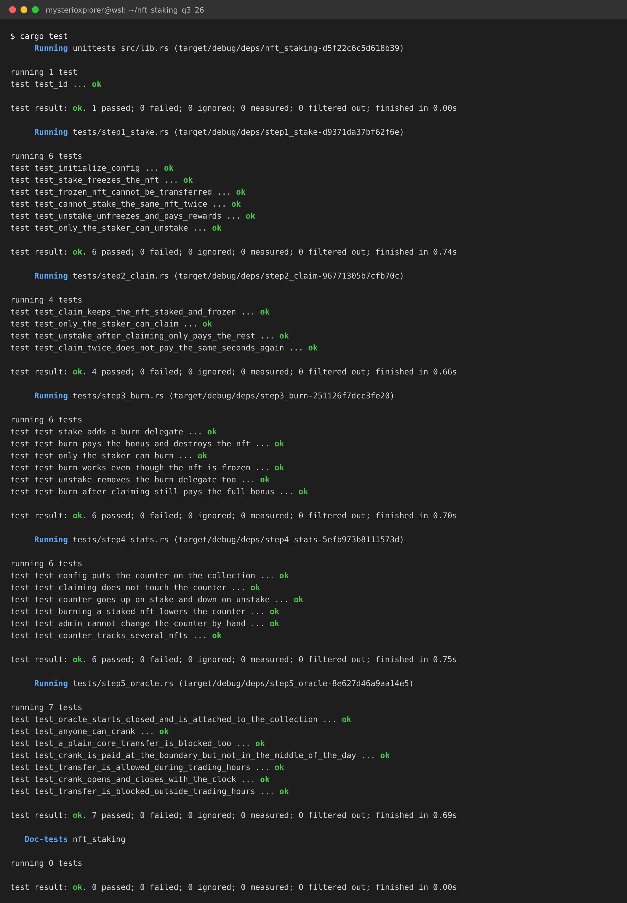

# NFT Staking on Metaplex Core

NFT staking built on [Metaplex Core](https://developers.metaplex.com/core), written in Anchor.
Users lock a Core asset, earn an SPL reward token over time, and can either claim, unstake,
or burn the NFT for a big one time bonus. The collection itself keeps a live count of how
many of its NFTs are staked.

Everything is tested with [LiteSVM](https://github.com/LiteSVM/litesvm) against the real
Core program dumped from mainnet.

## What was done

| Task | Where | Commit |
|------|-------|--------|
| Base staking (stake / unstake with FreezeDelegate) | `instructions/stake.rs`, `unstake.rs` | `base staking program` |
| 1.1 Claim rewards without unstaking | `instructions/claim_rewards.rs` | `task 1.1` |
| 1.2 Burn to earn with BurnDelegate | `instructions/burn_staked_nft.rs` | `task 1.2` |
| 1.3 Collection level stats via Attributes | `attributes.rs` | `task 1.3` |
| 2. Oracle plugin (time based transfer) | `instructions/initialize_oracle.rs`, `update_oracle.rs`, `transfer_nft.rs` | `task 2` |

Task 2 was the optional extended challenge, it is implemented and tested too.

## Instructions

| Instruction | Who can call it | What it does |
|-------------|-----------------|--------------|
| `initialize_config(points_per_day, burn_bonus)` | collection update authority | Creates the config and the reward mint, and puts the `total_staked` counter on the collection |
| `stake()` | asset owner | Freezes the NFT and starts earning |
| `claim_rewards()` | the staker | Pays out what has piled up, NFT stays staked and frozen |
| `unstake()` | the staker | Pays out, unfreezes, removes the plugins, closes the stake account |
| `burn_staked_nft()` | the staker | Pays out plus the burn bonus, then burns the NFT |
| `initialize_oracle(vault_funding)` | collection update authority | Creates the oracle account, funds the crank vault, attaches the Oracle adapter to the collection |
| `update_oracle()` | anyone | Reads the clock and flips the transfer state, pays the caller if they cranked at the right moment |
| `transfer_nft()` | asset owner | Transfers the NFT, passing the oracle as a remaining account |

## How it works

### Staking and freezing

`stake` adds two plugins to the asset, both with the stake PDA (`["stake", asset]`) as the
plugin authority:

- `FreezeDelegate { frozen: true }` so the NFT can't be moved or sold while staked
- `BurnDelegate` so `burn_staked_nft` can destroy it later

The user keeps owning the asset the whole time, they just can't move it. One thing worth
knowing: Core lets the *delegate* flip the `frozen` flag, but removing a plugin is the
*owner's* call, so `unstake` signs the unfreeze with the stake PDA and the removal with the
owner. Getting that backwards returns error `0x1a` ("Neither the asset or any plugins have
approved this operation"), which is what happened on my first attempt.

### Rewards

`points_per_day` reward tokens accrue per staked NFT, prorated by the second:

```
owed = (now - last_claim) * points_per_day / 86400
```

The reward mint is a PDA (`["rewards", config]`) whose mint authority is the config PDA, so
the program mints and nobody holds a key. `claim_rewards` only moves `last_claim` forward,
which is why claiming and then unstaking pays for the total time staked and not twice for
the same seconds (`test_unstake_after_claiming_only_pays_the_rest`).

### Task 1.3: the collection counter

`initialize_config` puts an `Attributes` plugin on the collection holding
`total_staked = "0"`, and sets the plugin authority to the config PDA. From then on:

- `stake` reads the attribute, adds one, writes it back
- `unstake` and `burn_staked_nft` subtract one

Because the plugin authority is the config PDA and not the admin, the admin can't edit the
number by hand even though they are still the collection's update authority
(`test_admin_cannot_change_the_counter_by_hand`). Reading the current value inside the
program uses `fetch_collection_plugin::<Attributes>`, and the writer keeps any other
attributes the collection already had.

### Task 2: the time based transfer oracle

Transfers are only allowed between 09:00 and 17:00 UTC.

- **Oracle account**: a PDA at `["oracle", collection]`, so its address is static and Core
  can always find it. It holds exactly one `OracleValidation`, nothing else. That matters:
  the adapter is registered with `ValidationResultsOffset::Anchor`, which tells Core to skip
  8 bytes (the Anchor discriminator) and read an `OracleValidation` from there, so any extra
  field on the struct would corrupt what Core reads.
- **Adapter**: registered on the collection with
  `lifecycle_checks: [(Transfer, ExternalCheckResult { flags: 4 })]`. Flag bit 2 is
  "can reject", so the oracle is only ever allowed to block a transfer, never to approve
  something that another plugin objected to.
- **The crank** (`update_oracle`) is permissionless: no authority check, anyone can call it.
  It reads `Clock`, works out whether the market is open and writes `Approved` or `Rejected`.
- **The reward**: lamports sit in a vault PDA (`["vault", collection]`). The caller is only
  paid when the call actually flips the state and happens within 15 minutes of an
  open/close boundary. A crank in the middle of the afternoon changes nothing and pays
  nothing, so the vault can't be farmed
  (`test_crank_is_paid_at_the_boundary_but_not_in_the_middle_of_the_day`).
- **Transferring**: `transfer_nft` CPIs `TransferV1` and passes the oracle account as a
  remaining account, which is how Core gets hold of it. The guard is on the asset itself,
  not on our program, so going straight to Core is blocked too
  (`test_a_plain_core_transfer_is_blocked_too`).

## Layout

```
programs/nft_staking/
  src/
    lib.rs                    the instruction entrypoints
    state.rs                  StakeConfig + StakeAccount (and the reward math)
    state_oracle.rs           OracleState, deliberately a single field
    attributes.rs             the total_staked counter on the collection
    rewards.rs                minting reward tokens with the config pda
    constants.rs, error.rs
    instructions/
      initialize_config.rs  stake.rs  unstake.rs
      claim_rewards.rs      burn_staked_nft.rs
      initialize_oracle.rs  update_oracle.rs  transfer_nft.rs
  tests/
    common/                   litesvm setup, core helpers, shared instruction builders
    step1_stake.rs ... step5_oracle.rs
tests/fixtures/mpl_core.so    the Core program, dumped from mainnet
```

## Building and testing

```bash
cargo build-sbf --manifest-path programs/nft_staking/Cargo.toml
```

```bash
cargo test
```

The tests load `target/deploy/nft_staking.so`, so the program has to be rebuilt before
running them after any change to the program. If you see `InstructionFallbackNotFound`,
that is a stale `.so`.

The Core program comes from mainnet:

```bash
solana program dump -u m CoREENxT6tW1HoK8ypY1SxRMZTcVPm7R94rH4PZNhX7d tests/fixtures/mpl_core.so
```

### All tests passing



## Tests

```
step1_stake    6   config setup, freeze on stake, frozen nft can't be transferred,
                   unstake pays and unfreezes, only the staker can unstake, no double staking
step2_claim    4   claim keeps it frozen, no double paying, claim then unstake, only the staker
step3_burn     6   burn delegate is added, bonus is paid, burn works while frozen,
                   burn after claiming, only the staker, unstake cleans both plugins up
step4_stats    6   counter created at 0, up on stake / down on unstake, several nfts,
                   burn lowers it, claiming doesn't touch it, admin can't fake it
step5_oracle   7   starts closed, opens and closes with the clock, anyone can crank,
                   paid only at the boundary, transfer allowed / blocked, plain core transfer blocked
```

30 tests in total.

## Notes on versions

- Anchor 0.32.1, because `mpl-core` 0.12 only ships Anchor integration for 0.31/0.32
  (`anchor-0-32` feature). `mpl-core`'s default `borsh-v1` feature has to be turned off,
  it is mutually exclusive with the Anchor one.
- Anchor 0.32 is built against the solana 2.x crates while LiteSVM uses the 3.x/4.x ones.
  `Pubkey` and `Instruction` are the same bytes on both sides, just different Rust types,
  so `tests/common/mod.rs` has a few small `to_svm_*` / `to_core_*` converters and
  everything else is normal.
- After a Core burn the asset account is not deleted, it is shrunk to a single byte holding
  `Key::Uninitialized`. So `is_burned` checks the key byte rather than the lamports.
